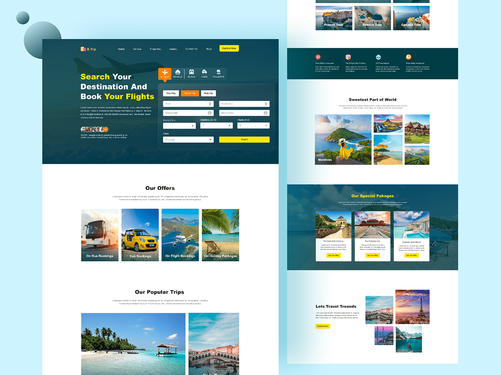
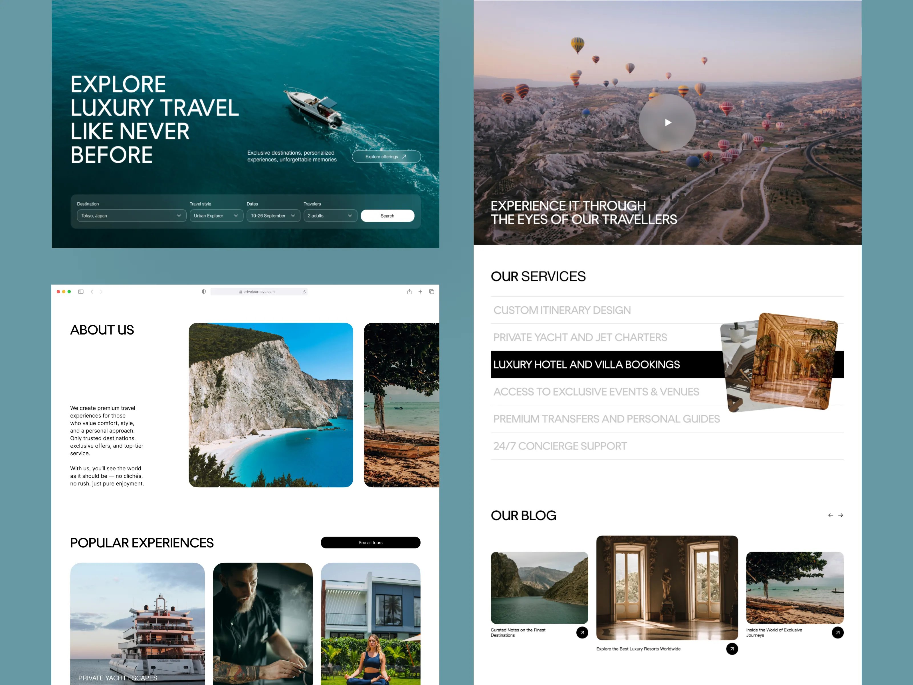
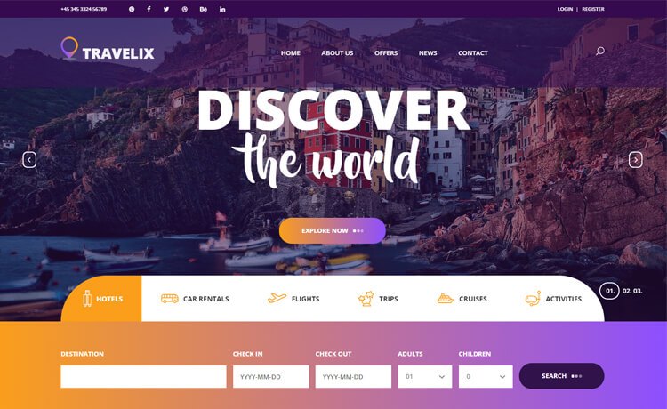

# medicenjeff-nextjs-wanderlust-explorer
Wanderlust Explorer — App Interactiva con React y Next.js

## Design References

1. [Travel Landing Page (Behance)](https://www.behance.net/gallery/123456789/Travel-Landing-Page) ([Bing](https://www.bing.com/search?q=%22https%3A%2F%2Fwww.behance.net%2Fgallery%2F123456789%2FTravel-Landing-Page%22&utm_source=copilot.com))

2. [Luxury Travel Agency Landing Page (Dribbble)](https://dribbble.com/shots/12345678-Luxury-Travel-Agency-Landing-Page) ([Bing](https://www.bing.com/search?q=%22https%3A%2F%2Fdribbble.com%2Fshots%2F12345678-Luxury-Travel-Agency-Landing-Page%22&utm_source=copilot.com))

3. [Travelix (Colorlib)](https://colorlib.com/wp/template/travelix/) ([Bing](https://www.bing.com/search?q=%22https%3A%2F%2Fcolorlib.com%2Fwp%2Ftemplate%2Ftravelix%2F%22&utm_source=copilot.com))

